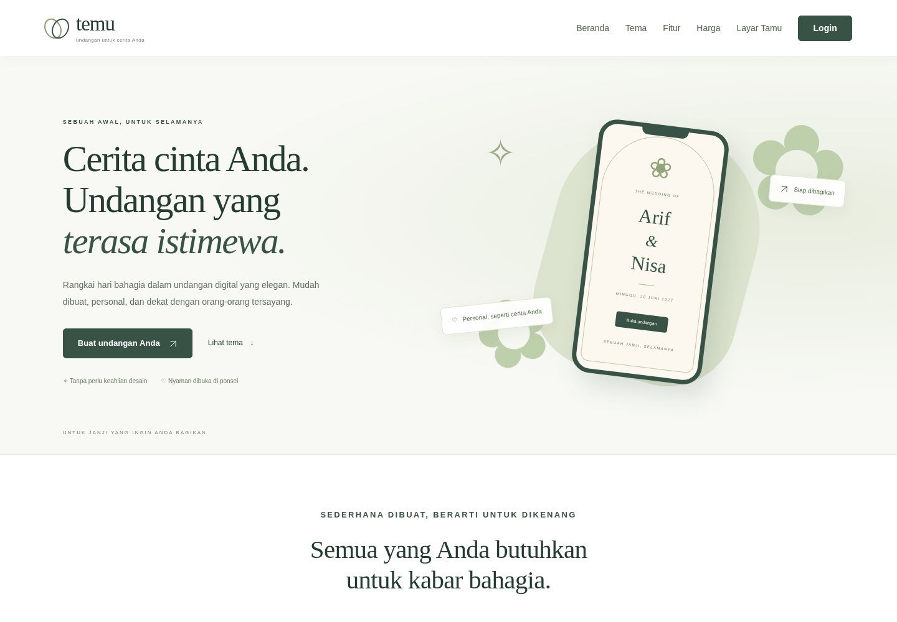
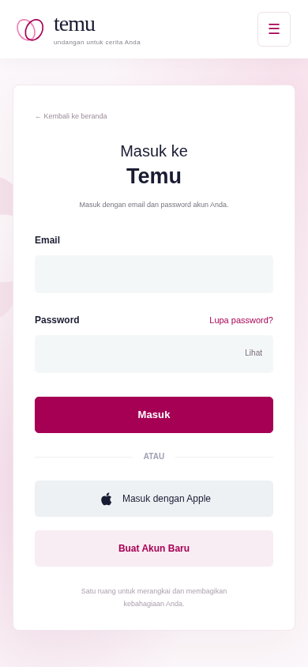

# Temu — Undangan Pernikahan Digital

Aplikasi full-stack berbahasa Indonesia untuk membuat undangan pernikahan. Backend **Node.js 24 + Express**, database **SQLite** untuk lokal atau **PostgreSQL** untuk hosting, pemrosesan foto **Sharp**, antarmuka HTML/CSS/JavaScript tanpa build. Aplikasi ini berdiri sendiri dalam repository `satusatukansaja11-spec/temu-undangan`, terpisah dari proyek monitoring keagamaan siswa.

## Menjalankan

```sh
git clone https://github.com/satusatukansaja11-spec/temu-undangan.git
cd temu-undangan
npm ci
cp .env.example .env
npm start
```

Buka `http://localhost:3000`. Node.js **24 atau lebih baru** diperlukan. `npm run dev` menjalankan mode watch. Tidak ada build frontend. Port dan URL publik ditentukan oleh `PORT` dan `APP_URL`. Pilih **Login → Buat Akun Baru** untuk mendaftar dengan nama, email dan password. Gunakan `DEMO_LOGIN=false` (default) untuk akun pribadi. Mode demo opsional hanya untuk pengujian lokal dan selalu dinonaktifkan saat `NODE_ENV=production`.

## Daftar dan masuk dengan akun pribadi

1. Jalankan aplikasi, buka `http://localhost:3000`, lalu pilih **Login → Buat Akun Baru**.
2. Isi nama, email, dan password 12–128 karakter. Setelah mendaftar, pengguna masuk ke dashboard pribadi.
3. Untuk masuk kembali, gunakan email dan password yang sama. Setiap pengguna hanya dapat mengelola undangannya sendiri.
4. Akun dan password yang sudah di-hash disimpan di SQLite pada `DATA_DIR`. Data tetap tersedia setelah aplikasi dimulai ulang selama direktori ini dipertahankan.

Tidak diperlukan konfigurasi Google OAuth. Tombol, endpoint dan konfigurasi login Google sudah dihapus. Jika `.env` lokal lama masih memuat `GOOGLE_CLIENT_ID` atau `GOOGLE_CLIENT_SECRET`, hapus kedua baris tersebut; aplikasi tidak lagi membacanya. Gunakan `DEMO_LOGIN=false` agar pengguna mendaftar akun pribadi, bukan menggunakan akun demo bersama.

Data pengguna dan undangan lama tidak dihapus. Akun provider tidak ditautkan otomatis ke akun email baru demi menjaga kepemilikan data. Jika sebelumnya pernah memakai login Google, sesi yang sudah aktif tetap mengikuti masa berlaku, tetapi login Google baru tidak tersedia; pemindahan kepemilikan akun lama memerlukan proses terverifikasi terpisah.

## Penyimpanan dan deployment mandiri

`DATA_DIR` (default `./data`) berisi `app.sqlite` dan `uploads/`. Migrasi SQL versioned dijalankan dengan `npm run db:migrate` (otomatis pada localhost jika `AUTO_MIGRATE=true`). Mode lokal tidak memerlukan akun database. Mode PostgreSQL memakai `DATABASE_URL`. Gunakan direktori/volume **persisten**, writable hanya oleh pengguna server. Simpan database dan uploads bersama dalam backup; gunakan SQLite backup API atau hentikan server sebelum menyalin database beserta WAL. Jangan menyajikan direktori data dengan static server.

Untuk hosting: Node 24, `npm ci`, `APP_URL=https://domain-anda`, `NODE_ENV=production`, `DEMO_LOGIN=false`, persistent volume `DATA_DIR`, reverse proxy HTTPS menuju port aplikasi. Mode SQLite menggunakan satu instance. Deployment multi-instance dapat memakai PostgreSQL dan S3-compatible storage yang kini didukung. Pasang rate limit dan batas request yang mencukupi audio (contoh 40 MB) pada reverse proxy untuk endpoint login/upload. Aplikasi membatasi tiap foto 10 MB secara default, galeri 200 foto, total 1.000 file foto per acara dan kuota media 2 GB secara default; semuanya dapat dikonfigurasi.

Aplikasi **belum diterbitkan ke internet**. Proyek ini adalah aplikasi Node.js mandiri dan memerlukan hosting yang mendukung proses Node.js serta volume penyimpanan persisten; GitHub Pages tidak menjalankan backend aplikasi ini. Link `/u/:slug` menjadi dapat diakses tamu setelah aplikasi di-host di domain publik. Pada localhost, tautan hanya berguna di mesin yang menjalankan server.

## Fitur dan alur

- Daftar dan login email/password, identitas dasar tersimpan, sesi 7 hari, keluar akun.
- Dashboard milik pengguna, pencarian, filter status, tampilan kosong, tambah/edit/pratinjau/hapus dengan konfirmasi.
- Formulir sembilan bagian: info dan tampilan, kedua mempelai, tanggal/waktu/lokasi, galeri, ucapan, love story, susunan acara tambahan, wedding gift, serta pengaturan/rekap RSVP.
- Wajib publikasi: nama acara; foto sampul, pria dan wanita; nama lengkap dan panggilan kedua mempelai; agama; tanggal; waktu mulai dan selesai; alamat; Maps HTTPS; pembuka dan penutup.
- Draft parsial dapat disimpan ke database. Seluruh isian valid dan lengkap membuat status **Siap Dibagikan**. Mengosongkan data wajib mengembalikan draft dan mencabut akses publik.
- Upload foto dengan pratinjau, multiple upload galeri, hapus dari susunan, pindah kiri/kanan. Foto diunggah langsung ke server; perubahan susunan/isian baru tersimpan setelah menekan **Simpan**. File yang gagal tidak dimasukkan, file berhasil tetap ada jika file berikutnya gagal. Upload sementara yang tidak dipakai tetap private sampai acara dihapus. Batas unggahan 1.000 foto secara default mencakup foto belum dipakai.
- Validasi browser serta decoding isi gambar di backend. Hanya JPEG, PNG, WebP; maksimal 10 MB secara default dan 40 megapiksel; metadata dibuang, dirotasi dan diubah menjadi WebP maksimal 2000×2000. SVG/HTML/gambar rusak ditolak.
- Salam sesuai pilihan agama; template baru diterapkan dengan tindakan pengguna. Perubahan agama tidak menimpa teks buatan pengguna.
- URL unik acak per acara, halaman publik tanpa identitas akun/ID internal, draft dan URL tak ditemukan ditangani.
- Musik `None`, lagu dari pustaka admin, atau **Melodi Temu**, instrumental sintetis orisinal yang dibuat aplikasi tanpa lisensi/layanan eksternal. Musik mulai saat Buka Undangan ditekan, dengan kontrol putar/jeda; `None` tidak membuat elemen audio. Lagu diunggah oleh admin melalui /admin; pelanggan hanya memilih dan menyimpan pilihan musik.
- Sebar membuka dialog pesan yang bisa diedit; tautan WhatsApp terisi teks dan URL. Pengguna sendiri membuka WhatsApp dan mengirim. Aplikasi tidak mengirim pesan otomatis.

Versi ini mengelola satu jadwal utama dan maksimal delapan rangkaian tambahan per pernikahan. `end` harus sesudah `start` pada tanggal sama; acara lintas tengah malam belum didukung. Pilih WIB/WITA/WIT untuk countdown dan kalender. Pembayaran produk memakai transfer bank manual dengan persetujuan admin. Jenis acara lain, AI eksternal dan pengiriman WhatsApp otomatis belum disediakan.

## Struktur penting

- `server.js`: entry point yang langsung menjalankan server, termasuk saat dimuat loader hosting.
- `app.js`: factory aplikasi, sesi, CSRF, otorisasi, API CRUD, upload dan halaman publik.
- `public/index.html`: shell halaman dan dialog aksesibel.
- `public/app.js`: dashboard, formulir, pratinjau, halaman undangan dan WhatsApp.
- `public/style.css`: desain sage/ivory, layout desktop/mobile dan reduced motion.
- `test/app.test.js`: pengujian integrasi backend dan keamanan dua akun.
- `.env.example`: daftar konfigurasi tanpa secret.
- `package-lock.json`: versi dependency terkunci.

Tabel `events` berelasi dengan `users`; `photos` berelasi dengan acara dengan cascade delete. Pasangan, jadwal, ucapan dan urutan galeri adalah dokumen JSON tervalidasi pada record acara agar penyimpanan perubahan undangan atomik. File gambar disimpan sebagai berkas, bukan base64 database. Model saat ini hanya pernikahan; tipe acara mendatang dapat ditambahkan melalui kolom jenis dan validator terpisah, tanpa mengekspos fitur acara lain sekarang.

## Pengujian

```sh
npm test
```

Pengujian menggunakan database dan direktori sementara, tanpa kredensial provider eksternal. Memeriksa akses anonim, CSRF/origin, pemilik palsu, akses silang dua pengguna (baca/ubah/hapus/upload), draft tersembunyi, foto palsu dan terlalu besar, rollback logis saat validasi gagal, URL foto tidak sah, publikasi lengkap, pencabutan publikasi, respons halaman/audio dan penghapusan relasi/file.

Alur manual:

1. Pilih Login → Buat Akun Baru, daftar dengan email/password, lalu buat acara.
2. Isi nama saja, Simpan; muat ulang, pastikan draft tetap tersimpan. Coba URL `/u/<slug>` dari browser tanpa sesi: harus ditolak.
3. Isi seluruh bagian wajib, upload foto, tambah/urutkan/hapus galeri, pilih agama, terapkan/edit salam, pilih musik, Simpan.
4. Buka Pratinjau, kembali dashboard, klik Sebar, ubah pesan; buka URL undangan pada browser privat. Foto dan Maps tampil, musik diam sebelum tombol putar ditekan.
5. Pilih None lalu Simpan: pemutar tidak ditampilkan.
6. Kosongkan data wajib, Simpan: link publik tidak lagi tersedia. Hapus acara dengan konfirmasi.
7. Daftar dan masuk dengan akun email kedua: daftar acara akun pertama tidak terlihat, endpoint milik akun pertama ditolak.
8. Periksa desktop, tablet dan layar ponsel, serta navigasi keyboard.

Hasil pengujian otomatis dan browser selama pengerjaan dirangkum dalam `VALIDATION.md`. Pendaftaran email tidak memerlukan konfigurasi provider eksternal.

## Halaman awal dan akun (pembaruan 24 Oktober 2026)

Halaman `/` kini merupakan beranda publik. Menu: **Beranda, Tema, Fitur, Harga, Login**. Menu section memakai anchor; Login menuju `/login`, Buat Akun Baru menuju `/daftar`, dan dashboard ada di `/dashboard`. Identitas Temu dipertahankan, dengan tampilan halaman awal putih/hijau/sage dan kartu login mengikuti referensi pengguna. Dashboard dan undangan yang sudah ada tetap tersedia.

- Tema menampilkan katalog **Navy Ivory**, **Sakura & Butterfly**, dan **Meihua Pavilion**. Preview memakai data ilustrasi, bukan acara pelanggan.
- Harga diatur pemilik melalui panel admin. Checkout transfer bank baru tersedia setelah rekening dan harga diaktifkan.
- Menu dan bagian Download kode aplikasi sudah dihapus dari beranda.
- Menu dan bagian Layar Tamu di beranda sudah dihapus. Route lama dipertahankan untuk kompatibilitas tautan yang sudah tersimpan.
- Form login email, toggle tampil/sembunyikan password, Apple, dan tautan pendaftaran akun.
- Pendaftaran email menggunakan nama, email, password 12–128 karakter. Password menggunakan scrypt asinkron dengan salt acak per akun. Tabel `credentials` dan `auth_limits` ditambahkan secara idempoten pada database yang sama. Password tidak disimpan sebagai plaintext.
- Pembatasan login/daftar: 10 percobaan per email dan 30 per alamat socket IP dalam 15 menit; pasang juga rate limit di reverse proxy. Semua pengguna di belakang reverse proxy dapat berbagi alamat socket IP yang sama; pertimbangkan konfigurasi pembatasan ingress untuk deployment Anda.
- Email/password dan akun Apple tidak ditautkan otomatis berdasarkan email. Menggunakan metode berbeda dapat menghasilkan akun terpisah. Gunakan metode login yang sama untuk mengakses undangan sebelumnya.
- Pendaftaran email belum memverifikasi kepemilikan alamat email melalui email konfirmasi. Pemulihan password melalui email belum tersedia; tombol Lupa password menjelaskan batasan ini. Jangan mengasumsikan email dari pendaftaran lokal sudah terverifikasi.

### Mengaktifkan Masuk dengan Apple

Tombol sudah terhubung ke endpoint OAuth backend. Untuk login nyata diperlukan keanggotaan dan konfigurasi **Apple Developer**, serta domain HTTPS; Apple tidak menerima localhost sebagai return URL web.

1. Siapkan primary App ID dengan capability **Sign in with Apple**, lalu buat **Services ID** untuk website dan kaitkan dengan primary App ID.
2. Dalam konfigurasi web Sign in with Apple, daftarkan domain aplikasi dan return URL persis `https://domain-anda/auth/apple/callback`.
3. Buat key Sign in with Apple dan simpan berkas `.p8` secara aman. Isi di server: `APPLE_CLIENT_ID` (Services ID), `APPLE_TEAM_ID`, `APPLE_KEY_ID`, dan `APPLE_PRIVATE_KEY` (isi private key PEM, mendukung karakter literal `\n` sebagai pemisah baris). Jangan mengunggah `.p8` atau nilai key ke GitHub.
4. Isi `APP_URL=https://domain-anda` tanpa slash akhir, mulai ulang server, lalu uji dari `/login`.

Backend membuat client secret ES256 berumur singkat, menukar authorization code, serta memverifikasi signature RS256 terhadap JWKS Apple, issuer, audience, masa berlaku, nonce dan email terverifikasi. State sekali pakai diikat pada cookie HttpOnly Secure SameSite=None untuk callback `form_post`. Dibutuhkan akses keluar server ke `https://appleid.apple.com`. Apple yang belum dikonfigurasi kembali ke halaman login dengan penjelasan; tidak ada login provider palsu.

File tambahan: `auth.js` (akun email dan Apple), `public/website.js` (beranda/login/daftar/layar tamu), `test/auth.test.js` (akun email dan verifikasi token Apple).

### Pratinjau tampilan

Beranda publik:



Halaman login pada ponsel:




## Undangan lengkap dan tampilan HP — 3 November 2026

Halaman publik `/u/:slug` kini memiliki cover, **countdown + Save the Date**, profil masing-masing mempelai, **love story**, **susunan acara**, **Maps**, **photo gallery**, **wedding gift**, dan **RSVP**. Navigasi tetap di bawah layar, target sentuh sekitar 44 px, form 16 px untuk menghindari zoom otomatis di HP, gambar galeri lazy-loaded, serta kontrol musik tidak menutup navigasi. Animasi menghormati reduced motion; musik mulai saat Buka Undangan ditekan.

### Pengisian dari dashboard

1. **Waktu & tempat**: pilih zona waktu acara (WIB/Jakarta, WITA/Makassar, WIT/Jayapura). Countdown dan kalender mengikuti zona tersebut, bukan zona browser tamu. Acara lama tanpa pilihan memakai WIB; sesuaikan jika lokasinya WITA/WIT.
2. **Love story**: maksimal 12 cerita dengan judul, tanggal opsional dan narasi. Teks seluruhnya dari pemilik acara; tidak ada kisah pribadi buatan otomatis.
3. **Susunan acara**: jadwal utama tetap dari Waktu & tempat. Tambahkan maksimal 8 rangkaian dengan nama, tanggal, waktu, lokasi dan link HTTPS Maps. Seluruh rangkaian memakai zona waktu acara yang dipilih.
4. **Wedding gift**: maksimal 3 rekening/e-wallet (nama bank, nomor, nama penerima) dan alamat pengiriman opsional. Informasi ini **ditampilkan kepada publik** jika diisi. Nomor dapat disalin dengan tombol; fallback memilih teks jika clipboard browser tidak tersedia. Tidak ada pembayaran, transfer otomatis, validasi rekening bank, atau penyimpanan data kartu.
5. **RSVP**: aktifkan/nonaktifkan formulir dan lihat rekap privat (hadir, tidak hadir, belum pasti, jumlah orang). Rekap memiliki paginasi 20 respons per halaman dan tombol muat ulang.
6. Simpan perubahan. Bagian tambahan bersifat opsional; jika menambahkan baris cerita/rangkaian/rekening yang belum lengkap, draft tetap bisa disimpan tetapi undangan belum siap dibagikan sampai baris dilengkapi atau dihapus. Bagian love story, galeri atau gift yang kosong tidak ditampilkan ke publik.

**Save the Date** mengunduh `.ics` untuk jadwal utama, dengan waktu UTC hasil konversi zona acara. Pengguna membuka/mengimpor berkas tersebut ke aplikasi kalender; aplikasi tidak menulis langsung ke akun kalender dan tidak memerlukan kredensial Google. Teks kalender di-escape dan baris panjang dilipat sesuai batas UTF-8. Kalender draft hanya tersedia bagi pemilik melalui pratinjau.

### RSVP, privasi dan penyimpanan

- Respons tersimpan di tabel SQLite baru `rsvps`, berelasi ke acara dengan cascade delete. `rsvp_limits` menyimpan pembatasan pengiriman. Schema ditambah secara idempoten; tabel/data acara lama tidak dihapus. Backup `DATA_DIR` sebelum memperbarui deployment yang memiliki data nyata.
- Tamu mengisi nama, kehadiran, jumlah tamu (1–10 termasuk dirinya jika hadir; 0 untuk tidak hadir/belum pasti) serta ucapan opsional. Tidak memerlukan akun tamu.
- Nama, ucapan dan rekap tidak diterbitkan dalam API data undangan; hanya pemilik terautentikasi dapat membaca daftar. API tamu hanya membaca responsnya sendiri dengan cookie rahasia HttpOnly, SameSite=Lax, Secure pada HTTPS; yang disimpan di database adalah hash token.
- Pada browser yang sama selama cookie masih tersedia (maksimal 180 hari), pengiriman berikutnya memperbarui respons. Cookie hilang, browser lain, atau perangkat lain dapat menghasilkan respons tambahan. Ini konfirmasi tamu anonim, **bukan verifikasi identitas/undangan individual**.
- Penulisan memeriksa Origin dan membatasi 60 pengiriman valid per IP socket per acara per jam, maksimal 10.000 respons per acara. Tambahkan proteksi ingress/anti-spam sesuai kebutuhan hosting; beberapa tamu di jaringan/proxy yang sama dapat berbagi pembatasan IP.
- Draft/tidak ditemukan menolak RSVP dan file kalender publik. RSVP yang dimatikan menolak pengiriman. Form di halaman pratinjau tidak mengirim data. Tidak ada email/WhatsApp otomatis saat RSVP.
- Cerita, rangkaian, gift, zona waktu dan pengaturan RSVP disimpan bersama dokumen acara tervalidasi; foto tetap berupa file di uploads.

File tambahan: `wedding.js` (validasi, kalender dan API RSVP), `public/wedding.js` (editor tambahan, undangan, countdown, galeri dan RSVP), `test/wedding.test.js` (integrasi dan keamanan).

### Pengujian alur baru

Jalankan `npm test`. Dari dashboard, lengkapi undangan, isi contoh cerita/rangkaian/gift, lalu simpan. Buka URL publik di browser tanpa login, unduh kalender, perbesar galeri, salin nomor dan kirim RSVP. Muat ulang dan ubah kehadiran: respons yang sama diperbarui. Kembali ke pemilik, buka tab RSVP untuk melihat rekap. Coba dari akun pemilik lain: akses rekap harus ditolak. Nonaktifkan RSVP atau ubah undangan menjadi draft dan pastikan akses publik ditolak sesuai status.

Pratinjau undangan (seluruh konten adalah data ilustrasi pengujian):

- [Tampilan HP](docs/images/undangan-mobile.png)
- [Tampilan desktop](docs/images/undangan-desktop.png)


## PostgreSQL, unggah lagu dan kapasitas foto — 3 November 2026

- **SQL hosting:** PostgreSQL dengan connection pool, migrasi SQL dan alat impor dari SQLite. Mode SQLite lokal tetap tersedia; akun/hash password/ID undangan dapat dipindahkan tanpa membuat ulang akun.
- **Penyimpanan:** disk lokal persisten atau bucket S3-compatible privat. Media tetap file, bukan base64 database. Akses publik hanya untuk media terpilih pada undangan siap dibagikan.
- **Pustaka musik admin:** admin unggah MP3/M4A/OGG/WAV maksimal 30 MB/30 menit melalui /admin; pelanggan memilih lagu lalu Simpan. Musik mulai saat Buka Undangan ditekan. Audio mendukung streaming/seek.
- **Foto banyak:** default 200 foto galeri, 1.000 unggahan per acara, 10 MB/foto dan total media 2 GB/acara, semuanya dapat dikonfigurasi. Pustaka dapat memakai ulang dan menghapus file yang tidak dipakai.
- **Hosting:** Dockerfile, Docker Compose PostgreSQL, healthcheck, contoh reverse proxy dan panduan HTTPS. Dukungan hosting sudah disiapkan; ini bukan konfirmasi website sudah terbit.

Baca [panduan hosting dan pemindahan data](docs/DEPLOYMENT.md) sebelum mengubah database atau penyimpanan. File SQL tersedia di [migrasi PostgreSQL](db/migrations/postgres) dan [migrasi SQLite](db/migrations/sqlite).

Lokal:

```sh
npm ci
npm run db:migrate
npm start
```

Untuk PostgreSQL, isi `DATABASE_URL` di `.env`, jalankan `npm run db:migrate`, lalu `npm start`. Untuk S3, buat bucket privat dan isi konfigurasi server sesuai panduan. Jangan menghapus data lokal lama sebelum hasil pemindahan diverifikasi.

[Pratinjau pustaka lagu di HP](docs/images/media-mobile.png) menggunakan data sintetis pengujian.

## Menu Sebar dan penerima personal

Klik **Sebar** pada undangan yang sudah siap dibagikan. Halaman menampilkan sampul, nama acara, pilihan template Universal/Formal/Custom dan template sesuai agama acara. Pesan dapat diedit menggunakan `{nama}`, `{acara}` dan `{link}`, lalu disimpan ke database.

Tambahkan nama penerima satu per satu atau import JSON berupa array nama (contoh `["Ummi Mahmud", "Bapak Arif & keluarga"]`, maksimal 500 nama per import, 200 KB/file, 1.000 penerima per acara). Export menghasilkan JSON nama. Nama dan pesan hanya dapat dikelola pemilik acara; penghapusan acara ikut menghapusnya melalui foreign key.

Setiap penerima mendapat tautan `/u/:slug?to=...` yang menampilkan sapaan pada sampul. Nama di URL adalah personalisasi, bukan identitas terverifikasi atau kode akses RSVP. URL dapat diedit/dibagikan ulang. Jangan memasukkan informasi rahasia ke nama penerima.

Tombol **Salin pesan**, **Kirim WA** dan **Bagikan tautan** tersedia per nama. Kirim WA membuka dialog pratinjau editable, lalu tautan berbagi WhatsApp. Pengguna memilih tujuan dan menekan Kirim di WhatsApp sendiri; aplikasi tidak mengirim otomatis/massal, tidak memilih nomor kontak dan tidak mengklaim pesan sudah terkirim. Browser tanpa Web Share memakai clipboard; bila clipboard ditolak, salin manual dari pratinjau.

SQL baru: `003_sharing.sql` untuk SQLite/PostgreSQL. Untuk server dengan `AUTO_MIGRATE=false`, jalankan `npm run db:migrate` sebelum memulai versi baru. Impor SQLite juga mencakup daftar penerima dan pengaturan pesan.

## Tampilan undangan Navy Ivory — 4 November 2026

Undangan publik/pratinjau kini memakai ornamen navy–ivory dengan ilustrasi botani dan paviliun yang dibuat berdasarkan nuansa referensi pengguna. Aset dekoratif lokal telah dioptimalkan ke WebP; foto dan nama mempelai tetap berasal dari data acara, bukan foto/nama contoh pada referensi.

Pada laptop (lebar 1024 px ke atas), foto sampul besar menetap di kiri, sementara panel undangan 480 px di kanan dapat digulir sendiri. Di HP/tablet, hanya satu kolom undangan ditampilkan. Sampul awal menampilkan foto berbingkai oval emas, nama mempelai, nama penerima dari tautan Sebar dan tombol Buka Undangan. Tombol membuka isi With Love, countdown, profil mempelai, cerita, jadwal, Maps, galeri, gift dan RSVP. Musik mulai saat Buka Undangan ditekan dan dapat dijeda lewat tombol musik.

With Love memakai ucapan pembuka pemilik acara. Tidak ada ayat atau salam agama yang ditambahkan otomatis dari gambar referensi. Pembaruan ini tidak mengubah schema database atau data acara.

Pratinjau menggunakan foto warna polos dari fixture pengujian; foto acara nyata akan menggantikannya:

- [Laptop](docs/images/navy-desktop.png)
- [HP — sampul](docs/images/navy-mobile-cover.png)
- [HP — profil mempelai](docs/images/navy-mobile-couple.png)

## Halaman pembuka dan Titip Hadiah — 4 November 2026

Setelah Buka Undangan, halaman pertama menampilkan **The Wedding Of**, nama panggilan pria dan wanita, lalu tombol melanjutkan isi undangan. Galeri foto berada tepat setelah Maps; jika belum ada foto, tersedia informasi kosong yang jelas. Titip Hadiah berada tepat sebelum penutup, setelah RSVP, dengan teks doa restu yang diminta pemilik proyek.

Dashboard: **Edit undangan → Titip Hadiah → Tambah Rekening**. Pilih bank/e-wallet atau Lainnya, masukkan nomor, atas nama dan keterangan opsional. Tombol **Simpan Perubahan** pada dialog menyimpan rekening beserta perubahan formulir undangan yang sedang berlangsung ke database. Edit/hapus tersedia pada setiap kartu; penghapusan meminta konfirmasi. Maksimal tiga rekening seperti batas aplikasi sebelumnya, tanpa paket berbayar buatan. Nomor rekening dipertahankan sebagai teks agar angka nol awal tidak hilang. Field keterangan opsional kompatibel dengan rekening lama yang belum memilikinya.

Kartu publik menggunakan nama bank dengan tipografi, dekorasi chip dan tombol salin; bukan klaim logo resmi atau verifikasi rekening. Data rekening hanya dari pengelola, bukan nomor contoh pada gambar referensi. Alamat kado fisik dapat ditampilkan melalui tombol jika telah diisi; tidak ada katalog penjualan, pembayaran atau transfer otomatis.

Pratinjau data sintetis: [dialog rekening](docs/images/rekening-modal.png) dan [Titip Hadiah di HP](docs/images/titip-hadiah-mobile.png).

Nama mempelai pada sampul undangan dan foto sampul besar di laptop memakai **Great Vibes**, dibundel lokal agar tidak membutuhkan Google Fonts saat halaman dibuka. Lisensi SIL OFL disertakan di `public/assets/fonts/GreatVibes-OFL.txt`. Font pada isi/profil dan halaman pengelola tetap seperti sebelumnya.

## Float in dan timeline susunan acara

Bagian undangan muncul dengan gerakan float in saat masuk area pandang, satu kali per elemen. Pada laptop pengamatan mengikuti panel undangan kanan, sedangkan di HP mengikuti halaman. Perubahan ukuran layar ditangani; reduced motion menampilkan konten tanpa animasi. Browser tanpa IntersectionObserver tetap menampilkan isi, dan formulir/navigasi tidak disembunyikan untuk efek animasi.

Susunan acara kini berupa timeline vertikal emas dengan posisi judul/deskripsi dan waktu bergantian, sesuai urutan jadwal utama lalu rangkaian tambahan. Tanggal, jam dan zona waktu tetap berasal dari acara pengguna. Tambahkan deskripsi opsional maksimal 1.000 karakter melalui Waktu & tempat untuk jadwal utama, atau Susunan acara untuk rangkaian tambahan. Jika deskripsi kosong, lokasi tetap ditampilkan sebagai keterangan. Tidak ada agenda contoh yang otomatis ditambahkan ke undangan nyata.

[Pratinjau timeline di HP](docs/images/timeline-mobile.png) memakai data pengujian.

## Pesan WhatsApp dan Sampai Selesai

Menu Sebar menyediakan template Sesuai agama (default mengikuti agama acara) dengan nama penerima, tanggal beserta hari, waktu/zona, lokasi dan tautan personal. Islam menggunakan salam pembuka/penutup dan format pesan yang diminta; agama lain memakai salam masing-masing. Template lama tetap tersimpan dan dapat diganti melalui pilihan template. Placeholder: `{nama}`, `{acara}`, `{tanggal}`, `{waktu}`, `{lokasi}`, `{link_undangan}` atau `{link}`.

Halaman publik mengirim metadata Open Graph langsung dari server, menggunakan judul dan foto sampul milik undangan siap dibagikan. WhatsApp perlu dapat mengakses domain HTTPS dan foto tanpa login; localhost tidak dapat dipakai untuk pratinjau eksternal. Cache dan tampilan kartu ditentukan WhatsApp; wa.me menyiapkan pesan dan tidak mengirim lampiran foto secara otomatis. Isi pesan tetap dapat ditinjau sebelum pengguna mengirimnya.

Pada Waktu & tempat, tombol Sampai Selesai di bawah jam selesai menonaktifkan jam tersebut; klik lagi untuk kembali mengisi waktu pasti. Pilihan tersimpan dalam data SQL acara, tanpa migrasi skema tambahan. Timeline dan pesan menampilkan jam mulai – Selesai. File kalender hanya ditawarkan saat waktu akhir pasti tersedia, sehingga aplikasi tidak mengarang jam selesai. Rangkaian tambahan tetap memakai jam selesai masing-masing.


## Panel admin pemilik

`/admin` menyediakan pencarian undangan pelanggan, koreksi tanggal dengan alasan dan audit, serta pustaka musik bersama (unggah/pratinjau/hapus). Pengguna biasa tidak dapat upload/hapus lagu melalui tampilan maupun API; foto tetap dapat diunggah seperti biasa. Lagu yang masih dipakai dilindungi dari penghapusan. Lagu lama per acara tetap dapat dipilih oleh pemiliknya untuk kompatibilitas.

Sesudah deploy dan migrasi, daftarkan akun pemilik lalu jalankan dari terminal server dengan database aplikasi yang sama:

```sh
npm run db:migrate
npm run admin:grant -- pemilik@example.com
```

Ganti email contoh dengan akun pribadi yang sudah terdaftar. Muat ulang/login dan buka `/admin`. Tidak ada admin default, tidak ada password bersama, dan pelanggan tidak dapat memilih peran saat mendaftar. Pencabutan: `npm run admin:revoke -- pemilik@example.com`. Lihat [panduan aktivasi](docs/DEPLOYMENT.md#panel-pemilik-dan-aktivasi-akses-admin).

[Pratinjau laptop](docs/images/admin-desktop.png) · [Pratinjau HP](docs/images/admin-mobile.png). Screenshot memakai akun dan lagu sintetis. Pembayaran transfer manual dan masa aktif sekali pakai kini tersedia; lihat bagian Pembelian tema di bawah.


## Pembelian tema dan undangan sekali pakai

Katalog berisi **Navy Ivory**, **Sakura & Butterfly**, dan **Meihua Pavilion**, masing-masing dengan Preview publik dan Select. Ilustrasi Sakura merupakan SVG orisinal terinspirasi referensi, dengan cabang bergoyang dan kupu-kupu mengepak; reduced motion menampilkan ornamen diam. Preview memakai data ilustrasi dan tidak mengirim RSVP atau memberikan hak akses.

Alur pelanggan: Select → login/daftar → pilih/buat draft acara → pesanan khusus acara → transfer → konfirmasi di aplikasi (bukti foto opsional) / WhatsApp → pemeriksaan mutasi oleh admin → acara terkait diaktifkan → Aktifkan & kunci tanggal. Konfirmasi pelanggan sendiri tidak membuka tema. Harga/rekening order disimpan sebagai snapshot. Persetujuan idempoten dan referensi mutasi yang sama tidak bisa membayar dua order.

Di `/admin`, pemilik mengisi **Rekening dan harga produk**, memeriksa isinya lalu mengaktifkan penjualan. Default: penjualan mati, rekening kosong, harga belum ditetapkan, WhatsApp `6282137665266` (dapat diganti). Rekening ini berbeda dari rekening hadiah mempelai. Tidak ada harga/rekening contoh yang diaktifkan di produksi. Pesanan baru terlihat di panel; WhatsApp membuka pesan siap kirim dan bukan notifikasi otomatis.

Setelah aktivasi, tanggal/zona waktu dikunci. Pelanggan dapat mengubah data lain sampai pukul 00.00 hari setelah tanggal pernikahan di WIB/WITA/WIT yang dipilih. Sesudahnya, server menolak edit, publikasi, RSVP dan media publik undangan tersebut. Akun, riwayat dan arsip tetap dapat dibaca. Acara baru memerlukan pembelian baru. Admin dapat mengoreksi tanggal selama masa aktif dengan alasan dan audit; koreksi tidak menghidupkan kembali arsip kedaluwarsa.

Migrasi 005 mempertahankan semua undangan yang sudah ada sebagai **legacy**; tidak menutup undangan lama secara retroaktif. Draft acara baru boleh dibuat sebelum pembayaran; aktivasi dan publikasi memerlukan pembayaran terpisah per acara. Lihat [aturan lengkap](rules.md) dan [panduan deployment](docs/DEPLOYMENT.md#penjualan-tema-transfer-manual-dan-migrasi-005).

Screenshot [katalog](docs/images/catalog-desktop.png), [Sakura di HP](docs/images/sakura-preview-mobile.png), dan [pesanan HP](docs/images/payment-order-mobile.png) menggunakan data/harga/rekening QA fiktif; bukan instruksi pembayaran nyata.


## Banyak acara dalam satu akun dan harga per tema

Dashboard menampilkan kartu acara tersendiri. **Tambah Acara** membuka formulir nama/tanggal rencana, lalu editor draft. Nama mempelai boleh berbeda dari pemilik akun: pengguna dapat mengelola undangan orang lain. Pembayaran hanya mengaktifkan satu acara yang dipilih. Dua acara bertema Sakura sekalipun memperoleh invoice berbeda; persetujuan tidak membuat acara duplikat. Preview pribadi/publikasi baru dibuka setelah pembayaran; Preview tema tetap memakai ilustrasi.

Di panel admin, kartu tiap tema menyediakan harga jual, harga normal opsional (0 tanpa promo), dan Preview. Harga yang dicoret dan persentase diskon mengikuti nilai yang benar-benar diatur admin. Select selalu membuka alur pemilihan; jika rekening/harga/penjualan belum siap, halaman memberi penjelasan dan tidak mengaktifkan pembayaran.

Untuk admin di localhost, jalankan Node.js dari folder proyek dan buka `http://localhost:3000/admin`, bukan URL folder XAMPP. Daftarkan/login akun pribadi, kemudian jalankan `npm run admin:grant -- email-anda@example.com` pada folder/database yang sama. Halaman tanpa hak admin menampilkan perintah dan tombol periksa ulang. Pada .env lokal gunakan APP_URL=http://localhost:3000 dan NODE_ENV=development; jangan mengganti .env hosting atau menghapus data saat memperbaiki localhost.

Logout kini menghapus sesi/cookie, mendukung sesi yang sudah habis, dan memberi umpan balik jika jaringan gagal. Permintaan lintas situs atau token CSRF salah tetap ditolak. Tidak ada akun admin bawaan.

[Dashboard banyak acara](docs/images/multi-event-dashboard.png) · [HP](docs/images/multi-event-mobile.png) · [Harga per tema](docs/images/theme-pricing-admin.png). Semua data/harga/rekening pada screenshot adalah contoh QA.


## Logo penutup, tema Meihua dan ucapan publik

Penutup seluruh tema menampilkan logo cincin dan tulisan Temu yang sama dengan merek beranda, menggantikan simbol ✳. Menu/bagian Layar Tamu tidak lagi ada di beranda.

Tema ketiga **Meihua Pavilion** memakai dua latar terpisah: sampul untuk bunga plum merah, isi untuk pegunungan/paviliun. Melalui `/admin → Latar Meihua Pavilion`, unggah JPG/PNG/WebP maksimal 10 MB untuk setiap slot; gambar dioptimalkan, metadata dibuang dan disimpan melalui storage local/S3. Katalog, preview, dan undangan mengikuti unggahan tersebut. Harga tema baru default 0 sampai ditentukan admin. Tanpa unggahan, gambar yang tampil merupakan ilustrasi SVG orisinal contoh, bukan kedua gambar asli dari pesan pengguna. Berkas sumber JPG/PNG gambar asli belum tersedia di workspace saat revisi dibuat.

Bagian **Ucapan dan Doa Para Tamu** menampilkan kartu yang bisa digulir, jumlah ucapan publik, agregat tamu hadir, tanggal, dan pagination. Checkbox persetujuan pada RSVP tidak dicentang otomatis. Nama/ucapan hanya dipublikasikan bila tamu menyetujuinya; konfirmasi kehadiran per tamu tetap privat. Ucapan lama tidak dibuka otomatis oleh migrasi. Pengirim dapat mengubah atau menarik persetujuan dari browser yang sama selama cookie tersedia. Pemilik undangan dapat menyembunyikan/menampilkan kembali ucapan melalui editor → RSVP. Edit oleh pengirim tidak membatalkan keputusan moderasi pemilik.

Deploy seluruh kode dan jalankan `npm run db:migrate` (migrasi 006). Backup database/media mencakup persetujuan, moderasi dan gambar tema; skrip impor/sinkronisasi sudah mencakupnya. Endpoint publik ucapan mengikuti batas publikasi/expiry yang sama dengan RSVP. Screenshot [ucapan HP](docs/images/public-wishes-mobile.png) dan [logo penutup](docs/images/closing-rings-mobile.png) memakai data sintetis dan ilustrasi contoh.

### Tema, latar dan beberapa rekening pembayaran

Acuan visual: [desain.MD](desain.MD). Katalog kini menyediakan Navy Ivory, Sakura & Butterfly, Meihua Pavilion, Jawa Heritage, dan Islamic Serenity, dalam satu baris yang dapat digeser.

Di **Admin → Rekening dan harga per tema**, isi rekening utama dan gunakan **Tambah rekening** untuk bank lain (maksimal 10 rekening). Simpan harga jual setiap tema dan aktifkan penjualan setelah rekening diperiksa. Pelanggan memilih bank tujuan sebelum membuat tagihan; nomor tujuan tetap tersimpan pada tagihan walaupun rekening admin kemudian diubah. Bank hanya bisa diganti pelanggan sebelum konfirmasi pembayaran dan sebelum tenggat.

Di **Admin → Menu Latar**, pilih tema melalui dropdown lalu unggah sampul dan/atau latar isi (JPG/PNG/WebP, maksimal 10 MB). Aset berlaku pada preview dan undangan tema tersebut. Foto pribadi mempelai tidak diganti. Dua tema baru belum dijual sampai harga diisi admin.

Daftar rekening disimpan dalam JSON konfigurasi `shop_settings` yang sudah ada; pembaruan ini tidak memerlukan migrasi SQL baru. Pengaturan lama dengan satu rekening tetap didukung. `.env` tetap privat dan tidak perlu dikirim ke GitHub.

### Owner Studio dan jumlah penggunaan tema

Panel `/admin` memiliki menu Ringkasan, Pesanan, Undangan, Pustaka musik, Rekening & harga, Menu latar, serta Aktivitas. Ringkasan menampilkan jumlah undangan, akun, pesanan, total pembayaran disetujui dan konfirmasi yang perlu diperiksa dari database. Hak akses tetap menggunakan `npm run admin:grant -- email-pemilik`.

Katalog menampilkan jumlah penggunaan setiap tema berdasarkan lisensi yang dibayar atau lisensi lama valid. Angka tidak ditambah secara fiktif ke 20; pesanan belum dibayar tidak dihitung. Tidak ada perubahan skema database untuk pembaruan ini. Deploy ulang dari kode GitHub agar `studio.css` dan tampilan admin baru tersedia di hosting.

### Mengunggah gambar bergerak untuk tema tertentu

1. Buka **Admin → Menu latar**, lalu pilih tema.
2. Di **Gambar bergerak**, pilih satu atau beberapa PNG/WebP berlatar transparan. Daun yang menyatu dengan gambar latar perlu dipisahkan lebih dahulu menggunakan editor gambar.
3. Tentukan halaman, sudut, gerakan, ukuran dan durasi, lalu tekan **Simpan gambar ornamen**. Maksimal 12 gambar per tema, 5 MB per gambar. Gambar disimpan sebagai WebP yang dioptimalkan.
4. Edit pengaturan setiap gambar, nonaktifkan sementara, atau hapus sesuai kebutuhan. **Preview gerakan tema** membuka hasilnya. Gambar tidak otomatis ditambahkan ke tema lain.

Pembaruan menggunakan migrasi **007_theme_ornaments.sql** untuk SQLite dan PostgreSQL. Jalankan `npm run db:migrate` sebelum restart jika migrasi otomatis dinonaktifkan; konfigurasi `AUTO_MIGRATE=true` menjalankannya saat startup. Backup database sebelum pembaruan. Tidak perlu mengunggah `.env` ke GitHub. Skrip impor SQLite ke PostgreSQL dan sinkronisasi penyimpanan menyertakan aset ornamen.

Kotak countdown mengikuti warna masing-masing tema. Untuk tema baru, gunakan token CSS `--countdown-bg`, `--countdown-text` dan `--countdown-border`; warna dasar tersedia sebagai fallback. Animasi dekorasi menghormati pengaturan pengurangan gerakan perangkat.

### Paket Pro, Premium dan katalog slide

Katalog menyediakan 20 tema: 5 tema sebelumnya ditambah 5 Elegan, 5 Flower/Bunga dan 5 Islami. Setiap kategori memiliki slide yang dapat digeser atau dipindahkan memakai panah. Data desain bersama ada di `public/theme-library.js`; semua tema tersedia pada Preview, checkout, dropdown latar dan ornamen admin.

**Admin → Rekening & harga** menyediakan harga jual/normal Pro dan Premium untuk setiap tema serta keterangan paket. Nilai 0 berarti paket belum dijual. Harga Pro lama tetap digunakan sebagai harga Pro; Premium dan tema baru default 0 sampai diisi pemilik. Pengguna memilih paket pada checkout; nama paket dan nominal tersimpan pada pesanan serta terlihat oleh admin/pelanggan.

Pro mengizinkan 10 foto galeri. Premium mengizinkan 20 foto, Love Story, link video/live streaming, gulir otomatis, peta Google Maps tertanam, font nama dan warna aksen. Pengaturan tambahan tersedia di editor **Info & tampilan**. Gulir otomatis baru bergerak setelah tombol ditekan, berhenti saat pengguna menggulir manual/tab disembunyikan dan menghormati reduced motion. Warna tombol/countdown memakai teks putih atau gelap sesuai kontras. Peta tertanam memakai alamat acara dan hanya origin Google yang diizinkan CSP; link Maps tetap tersedia.

Fitur referensi disesuaikan dengan proyek: satu acara/satu pembayaran, tanggal terkunci dan masa aktif mengikuti hari pernikahan tetap berlaku; musik dikelola admin. QR check-in dan balasan ucapan mempelai ditandai belum tersedia. Data lama tidak dihapus ketika batas galeri paket diperkenalkan.

Pembaruan memerlukan migrasi **008_packages.sql**. Pesanan lama diberi label Pro tanpa mengubah harga/status. Dengan `AUTO_MIGRATE=true`, migrasi berjalan saat startup. Jika dinonaktifkan, jalankan `npm run db:migrate` sebelum restart. Backup database sebelum memperbarui hosting. Skrip impor SQLite → PostgreSQL mendukung kolom paket dan sumber lama tanpa kolom tersebut. `.env` tetap privat.

Harga per tema kini dipilih melalui dropdown pada **Admin → Rekening & harga**, seperti **Menu Latar**. Pilih tema, isi harga Pro/Premium, lalu simpan; perubahan beberapa tema tetap dipertahankan saat berpindah pilihan. Kartu Paket Undangan menampilkan daftar ringkas sampai **Revisi selama masa aktif**, dengan **Tampilkan lebih banyak** untuk membuka sisanya. Pembaruan tampilan ini tidak memerlukan migrasi database tambahan.

Memilih file ornamen belum menyimpan gambar. Setelah pratinjau bertanda **belum disimpan** muncul, klik **Simpan gambar ornamen** di atas/bawah pengaturan. Tunggu pesan **berhasil disimpan** dan daftar **Ornamen tersimpan**, lalu klik **Lihat hasil tema**. Untuk mengubah posisi/gerakan gambar yang sudah ada, klik **Simpan perubahan ornamen** pada gambar tersebut. Halaman **Sampul** tampil sebelum Buka Undangan; **Halaman nama** dan halaman lain tampil di dalam undangan. Gunakan PNG/WebP dengan transparansi; kesalahan file/unggahan ditampilkan pada formulir.
