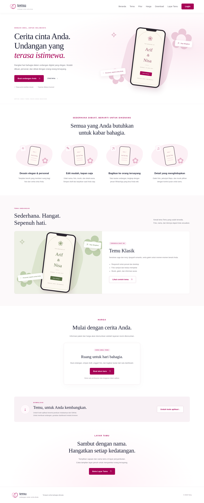
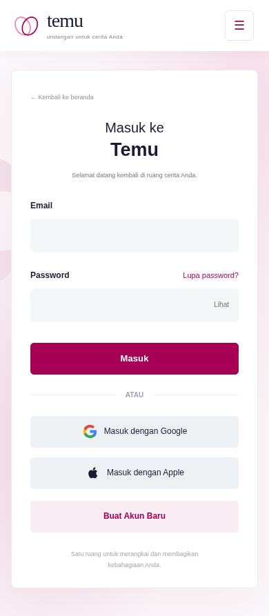

# Temu — Undangan Pernikahan Digital

Aplikasi full-stack berbahasa Indonesia untuk membuat undangan pernikahan. Backend **Node.js 24 + Express**, database **SQLite** bawaan Node, pemrosesan foto **Sharp**, antarmuka HTML/CSS/JavaScript tanpa build. Aplikasi ini berdiri sendiri dalam repository `satusatukansaja11-spec/temu-undangan`, terpisah dari proyek monitoring keagamaan siswa.

## Menjalankan

```sh
git clone https://github.com/satusatukansaja11-spec/temu-undangan.git
cd temu-undangan
npm ci
cp .env.example .env
npm start
```

Buka `http://localhost:3000`. Node.js **24 atau lebih baru** diperlukan. `npm run dev` menjalankan mode watch. Tidak ada build frontend. Port dan URL publik ditentukan oleh `PORT` dan `APP_URL`. Untuk sekadar mencoba lokal tanpa akun Google, isi `DEMO_LOGIN=true`, lalu pilih **Coba akun demo lokal**. Ini satu akun demo bersama pada mesin tersebut, bukan login produksi. Mode demo selalu dinonaktifkan saat `NODE_ENV=production`.

## Konfigurasi Google OAuth

1. Buat project di Google Cloud Console, konfigurasi Google Auth Platform/OAuth consent screen (aplikasi eksternal atau internal sesuai organisasi).
2. Buat OAuth client jenis **Web application**.
3. Daftarkan authorized redirect URI lokal: `http://localhost:3000/auth/google/callback`. Untuk produksi: `https://domain-anda/auth/google/callback`.
4. Isi `GOOGLE_CLIENT_ID` dan `GOOGLE_CLIENT_SECRET` pada `.env` di server. Jangan letakkan secret di frontend atau commit `.env`.
5. Sesuaikan `APP_URL` persis dengan origin aplikasi (tanpa slash akhir). Dalam mode OAuth Testing, daftarkan alamat Google penguji sebagai test user. Untuk penggunaan umum, selesaikan proses publikasi/validasi Google yang berlaku.
6. Mulai ulang server, klik **Masuk dengan Google**. Sesudah berhasil login, dashboard terbuka.

Scope: `openid email profile`. OAuth menggunakan state terikat cookie, PKCE S256, state sekali pakai kedaluwarsa 10 menit, dan pemeriksaan email terverifikasi dari Google UserInfo. Access token Google hanya digunakan pada backend untuk mengambil profil; tidak dikirim ke browser atau disimpan di database. Callback gagal kembali ke halaman login dengan pesan aman.

Server perlu akses HTTPS ke `oauth2.googleapis.com` dan `openidconnect.googleapis.com`; browser ke `accounts.google.com`. Login Google nyata belum diuji karena tidak ada kredensial, dan policy jaringan lingkungan pengerjaan tidak mengizinkan endpoint Google tersebut. Tidak ada kredensial palsu atau autentikasi Google simulasi.

## Penyimpanan dan deployment mandiri

`DATA_DIR` (default `./data`) berisi `app.sqlite` dan `uploads/`. Schema dibuat idempoten saat server pertama berjalan. Tidak perlu akun database atau connection string. Gunakan direktori/volume **persisten**, writable hanya oleh pengguna server. Simpan database dan uploads bersama dalam backup; gunakan SQLite backup API atau hentikan server sebelum menyalin database beserta WAL. Jangan menyajikan direktori data dengan static server.

Untuk hosting: Node 24, `npm ci`, env Google dan `APP_URL=https://domain-anda`, `NODE_ENV=production`, `DEMO_LOGIN=false`, persistent volume `DATA_DIR`, reverse proxy HTTPS menuju port aplikasi. Hanya satu instance aplikasi yang menggunakan direktori SQLite lokal; deployment multi-instance membutuhkan migrasi database dan object storage bersama. Pasang rate limit dan batas request 6 MB pada reverse proxy untuk endpoint login/upload. Aplikasi membatasi tiap foto 5 MB, galeri 20 foto dan total unggahan 100 per acara.

Aplikasi **belum diterbitkan ke internet**. Proyek ini adalah aplikasi Node.js mandiri dan memerlukan hosting yang mendukung proses Node.js serta volume penyimpanan persisten; GitHub Pages tidak menjalankan backend aplikasi ini. Link `/u/:slug` menjadi dapat diakses tamu setelah aplikasi di-host di domain publik. Pada localhost, tautan hanya berguna di mesin yang menjalankan server.

## Fitur dan alur

- Login Google, identitas dasar tersimpan, sesi 7 hari, keluar akun.
- Dashboard milik pengguna, pencarian, filter status, tampilan kosong, tambah/edit/pratinjau/hapus dengan konfirmasi.
- Formulir lima bagian: info dan tampilan, kedua mempelai, tanggal/waktu/lokasi, galeri, ucapan.
- Wajib publikasi: nama acara; foto sampul, pria dan wanita; nama lengkap dan panggilan kedua mempelai; agama; tanggal; waktu mulai dan selesai; alamat; Maps HTTPS; pembuka dan penutup.
- Draft parsial dapat disimpan ke database. Seluruh isian valid dan lengkap membuat status **Siap Dibagikan**. Mengosongkan data wajib mengembalikan draft dan mencabut akses publik.
- Upload foto dengan pratinjau, multiple upload galeri, hapus dari susunan, pindah kiri/kanan. Foto diunggah langsung ke server; perubahan susunan/isian baru tersimpan setelah menekan **Simpan**. File yang gagal tidak dimasukkan, file berhasil tetap ada jika file berikutnya gagal. Upload sementara yang tidak dipakai tetap private sampai acara dihapus. Batas unggahan 100 mencakup foto sementara.
- Validasi browser serta decoding isi gambar di backend. Hanya JPEG, PNG, WebP; maksimal 5 MB dan 40 megapiksel; metadata dibuang, dirotasi dan diubah menjadi WebP maksimal 2000×2000. SVG/HTML/gambar rusak ditolak.
- Salam sesuai pilihan agama; template baru diterapkan dengan tindakan pengguna. Perubahan agama tidak menimpa teks buatan pengguna.
- URL unik acak per acara, halaman publik tanpa identitas akun/ID internal, draft dan URL tak ditemukan ditangani.
- Musik `None` atau **Melodi Temu**, instrumental sintetis orisinal yang dibuat aplikasi tanpa lisensi/layanan eksternal. Kontrol putar/jeda, tanpa autoplay; `None` tidak membuat elemen audio. Untuk menambah katalog musik, perluas whitelist backend, endpoint audio, dan pilihan form.
- Sebar membuka dialog pesan yang bisa diedit; tautan WhatsApp terisi teks dan URL. Pengguna sendiri membuka WhatsApp dan mengirim. Aplikasi tidak mengirim pesan otomatis.

Versi ini mengelola satu rangkaian jadwal utama per pernikahan, dengan label bebas (misalnya Akad & Resepsi). `end` harus sesudah `start` pada tanggal sama; acara lintas tengah malam belum didukung. Waktu ditampilkan sebagai waktu setempat lokasi acara. Jenis acara lain, RSVP, pembayaran, AI eksternal dan pengiriman WhatsApp otomatis tidak dibuat.

## Struktur penting

- `server.js`: schema, Google OAuth, sesi, CSRF, otorisasi, API CRUD, upload dan halaman publik.
- `public/index.html`: shell halaman dan dialog aksesibel.
- `public/app.js`: dashboard, formulir, pratinjau, halaman undangan dan WhatsApp.
- `public/style.css`: desain sage/ivory, layout desktop/mobile dan reduced motion.
- `test/app.test.js`: pengujian integrasi backend dan keamanan dua akun.
- `.env.example`: daftar konfigurasi tanpa secret.
- `package-lock.json`: versi dependency terkunci.

Tabel `events` berelasi dengan `users`; `photos` berelasi dengan acara dengan cascade delete. Pasangan, jadwal, ucapan dan urutan galeri adalah dokumen JSON tervalidasi pada record acara agar penyimpanan perubahan undangan atomik. File gambar disimpan sebagai berkas, bukan base64 database. Model saat ini hanya pernikahan; tipe acara mendatang dapat ditambahkan melalui kolom jenis dan validator terpisah, tanpa mengekspos fitur acara lain sekarang.

## Pengujian

```sh
npm test
```

Pengujian menggunakan database dan direktori sementara, tanpa kredensial Google. Memeriksa akses anonim, CSRF/origin, pemilik palsu, akses silang dua pengguna (baca/ubah/hapus/upload), draft tersembunyi, foto palsu dan terlalu besar, rollback logis saat validasi gagal, URL foto tidak sah, publikasi lengkap, pencabutan publikasi, respons halaman/audio dan penghapusan relasi/file.

Alur manual:

1. Aktifkan demo lokal atau isi Google OAuth; masuk, buat acara.
2. Isi nama saja, Simpan; muat ulang, pastikan draft tetap tersimpan. Coba URL `/u/<slug>` dari browser tanpa sesi: harus ditolak.
3. Isi seluruh bagian wajib, upload foto, tambah/urutkan/hapus galeri, pilih agama, terapkan/edit salam, pilih musik, Simpan.
4. Buka Pratinjau, kembali dashboard, klik Sebar, ubah pesan; buka URL undangan pada browser privat. Foto dan Maps tampil, musik diam sebelum tombol putar ditekan.
5. Pilih None lalu Simpan: pemutar tidak ditampilkan.
6. Kosongkan data wajib, Simpan: link publik tidak lagi tersedia. Hapus acara dengan konfirmasi.
7. Login dengan akun Google kedua: daftar acara akun pertama tidak terlihat, endpoint milik akun pertama ditolak.
8. Periksa desktop, tablet dan layar ponsel, serta navigasi keyboard.

Hasil pengujian otomatis dan browser selama pengerjaan dirangkum dalam `VALIDATION.md`. Login Google nyata memerlukan konfigurasi Anda dan verifikasi tersendiri sebelum produksi.

## Halaman awal dan akun (pembaruan 24 Oktober 2026)

Halaman `/` kini merupakan beranda publik. Menu: **Beranda, Tema, Fitur, Harga, Download, Layar Tamu, Login**. Menu section memakai anchor; Login menuju `/login`, Buat Akun Baru menuju `/daftar`, dan dashboard ada di `/dashboard`. Identitas Temu dipertahankan, dengan tampilan publik putih/magenta dan kartu login mengikuti referensi pengguna. Dashboard dan undangan yang sudah ada tetap tersedia.

- Tema menampilkan contoh **Temu Klasik**, tema undangan yang saat ini tersedia. Contoh memakai data ilustrasi, bukan acara pelanggan.
- Harga belum ditentukan; halaman menjelaskan bahwa paket belum diumumkan, tanpa pembayaran atau checkout.
- Download mengunduh ZIP kode aplikasi dari repository GitHub. Ini bukan aplikasi Android/iOS.
- Layar Tamu (`/layar-tamu`) menampilkan nama yang diketik petugas dan dapat dibuka layar penuh. Nama hanya berada dalam memori halaman perangkat, tanpa database tamu, RSVP atau sinkronisasi.
- Form login email, toggle tampil/sembunyikan password, Google, Apple, dan tautan pendaftaran akun.
- Pendaftaran email menggunakan nama, email, password 12–128 karakter. Password menggunakan scrypt asinkron dengan salt acak per akun. Tabel `credentials` dan `auth_limits` ditambahkan secara idempoten pada database yang sama. Password tidak disimpan sebagai plaintext.
- Pembatasan login/daftar: 10 percobaan per email dan 30 per alamat socket IP dalam 15 menit; pasang juga rate limit di reverse proxy. Semua pengguna di belakang reverse proxy dapat berbagi alamat socket IP yang sama; pertimbangkan konfigurasi pembatasan ingress untuk deployment Anda.
- Email/password dan akun Google/Apple tidak ditautkan otomatis berdasarkan email. Menggunakan metode berbeda dapat menghasilkan akun terpisah. Gunakan metode login yang sama untuk mengakses undangan sebelumnya.
- Pendaftaran email belum memverifikasi kepemilikan alamat email melalui email konfirmasi. Pemulihan password melalui email belum tersedia; tombol Lupa password menjelaskan batasan ini. Jangan mengasumsikan email dari pendaftaran lokal sudah terverifikasi.

### Mengaktifkan Masuk dengan Apple

Tombol sudah terhubung ke endpoint OAuth backend. Untuk login nyata diperlukan keanggotaan dan konfigurasi **Apple Developer**, serta domain HTTPS; Apple tidak menerima localhost sebagai return URL web.

1. Siapkan primary App ID dengan capability **Sign in with Apple**, lalu buat **Services ID** untuk website dan kaitkan dengan primary App ID.
2. Dalam konfigurasi web Sign in with Apple, daftarkan domain aplikasi dan return URL persis `https://domain-anda/auth/apple/callback`.
3. Buat key Sign in with Apple dan simpan berkas `.p8` secara aman. Isi di server: `APPLE_CLIENT_ID` (Services ID), `APPLE_TEAM_ID`, `APPLE_KEY_ID`, dan `APPLE_PRIVATE_KEY` (isi private key PEM, mendukung karakter literal `\n` sebagai pemisah baris). Jangan mengunggah `.p8` atau nilai key ke GitHub.
4. Isi `APP_URL=https://domain-anda` tanpa slash akhir, mulai ulang server, lalu uji dari `/login`.

Backend membuat client secret ES256 berumur singkat, menukar authorization code, serta memverifikasi signature RS256 terhadap JWKS Apple, issuer, audience, masa berlaku, nonce dan email terverifikasi. State sekali pakai diikat pada cookie HttpOnly Secure SameSite=None untuk callback `form_post`. Dibutuhkan akses keluar server ke `https://appleid.apple.com`. Google dan Apple yang belum dikonfigurasi kembali ke halaman login dengan penjelasan; tidak ada login provider palsu.

File tambahan: `auth.js` (akun email dan Apple), `public/website.js` (beranda/login/daftar/layar tamu), `test/auth.test.js` (akun email dan verifikasi token Apple).

### Pratinjau tampilan

Beranda publik:



Halaman login pada ponsel:


